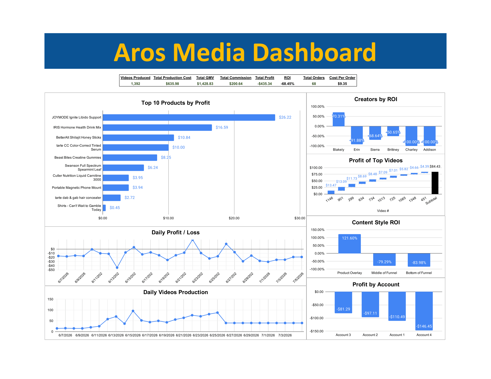

# Aros Media: Content Performance Profitability Dashboard

## Overview

This project analyzes content performance and financial profitability for Aros Media using Microsoft Excel. It connects video-level performance metrics with production costs, commission revenue, and operating expenses to evaluate content efficiency and support data-driven business decisions.

The workbook combines an interactive-style dashboard, management profit and loss reporting, unit economics, cost structure analysis, and business recommendations into a single analytical tool.

## Business Objectives

The project aims to answer several key business questions:

- Which products, creators, and content formats generate the strongest financial returns?
- How effectively does video production translate into commission revenue and orders?
- What are the primary drivers of production and operating expenses?
- Which unit economics metrics reveal opportunities to improve profitability?
- How should production resources and operating spending be allocated to improve financial performance?

## Tools & Skills

- **Microsoft Excel:** Formulas, data organization, pivot tables, KPI calculations, and dashboard development.
- **Financial Analysis:** Management P&L reporting, expense analysis, and profitability assessment.
- **Unit Economics:** Revenue per video, cost per order, profit per video, and ROI analysis.
- **Data Analysis:** Performance comparisons across products, creators, accounts, and content formats.
- **Business Intelligence:** KPI reporting, data visualization, interpretation of results, and business recommendations.

## Key Metrics

The workbook analyzes 1,392 videos and includes the following aggregate metrics:

| Metric | Result |
|---|---:|
| Videos produced | 1,392 |
| Commission revenue | $200.64 |
| Gross merchandise value (GMV) | $1,428.83 |
| Orders | 68 |
| Production expenses | $635.98 |
| Total expenses | $1,965.97 |
| Gross loss after production expenses | -$435.34 |
| Operating loss after all recorded expenses | -$1,765.33 |

These figures represent the results recorded in the workbook. GMV represents the value of merchandise sold, whereas commission revenue represents the revenue earned by Aros Media.

## Workbook Structure

The workbook contains eight worksheets:

| Worksheet | Description |
|---|---|
| Dashboard | Consolidated view of video output, production costs, GMV, commission revenue, profitability, ROI, orders, and cost per order. |
| Management P&L | Financial statement showing commission revenue, production expenses, operating expenses, and operating profit or loss. |
| Unit Economics | Analysis of commission per video, production cost per video, profit per order, cost per order, and ROI. |
| Cost Structure | Breakdown of production and operating expenses by category. |
| Business Findings | Summary of analytical findings and recommendations for production and spending decisions. |
| Video Database | Underlying video-level production records and associated costs. |
| Performance Data | Video performance metrics, including GMV, orders, commission, clicks, and impressions. |
| Pivot Tables | Aggregated metrics used to compare and evaluate content performance and profitability. |

## Methodology

1. Organize video production records and performance data into structured worksheets.
2. Evaluate video-level metrics, including orders, GMV, commission revenue, and production costs.
3. Compare financial performance across products, creators, accounts, and content formats.
4. Calculate unit economics metrics to assess revenue generation, cost efficiency, and return on investment.
5. Consolidate commission revenue, production expenses, and operating expenses into a management P&L.
6. Analyze expense categories to identify major cost drivers.
7. Translate the results into recommendations for production allocation, content strategy, and expense management.

## Key Findings & Business Recommendations

The analysis highlights several areas for further investigation and potential improvement:

- **Product performance:** Prioritize further testing of products identified as having strong video-level profit and ROI, while validating that results remain positive across additional videos.
- **Creator performance:** Evaluate differences in profitability across creators and allocate production resources based on consistent, repeatable results.
- **Content formats:** Investigate which formats generate positive returns and reduce investment in formats that consistently underperform.
- **Production efficiency:** Assess whether increasing posting volume improves total profitability without causing marginal production costs to exceed incremental commission revenue.
- **Operating expenses:** Review subscriptions and other operating costs, which represent a significant portion of total expenses.
- **Profitability improvement:** Focus on improving the relationship between production spending, operating expenses, and commission revenue.

These recommendations should be evaluated against the underlying data and monitored over time to determine whether changes improve financial performance.

## Files

- `aros_media_content_performance_profitability_dashboard.xlsx` - Complete Excel workbook containing the dashboard, supporting analysis, and business findings.
- `data/` - Supporting raw data.
- `images/` - Dashboard screenshots and project visuals.

## How to Use

1. Download the Excel workbook from this repository.
2. Open the workbook in Microsoft Excel.
3. Start with the Dashboard for an overview of performance and financial results.
4. Review the Management P&L, Unit Economics, and Cost Structure worksheets for supporting analysis.
5. Explore the Video Database, Performance Data, and Pivot Tables worksheets to examine the underlying records and calculations.
6. Review Business Findings for the resulting conclusions and recommended actions.

## Skills Demonstrated

Financial Analysis · Microsoft Excel · Unit Economics · Data Analysis · KPI Development · Profit & Loss Reporting · Cost Analysis · Dashboard Development · Business Decision Support
